# Login Enterprise Power BI Custom Report Connector

## Summary

This guide provides step-by-step instructions for setting up and using the **Login Enterprise Power BI custom report connector** and also details on the Power BI Template file that is available to use with your Login Enterprise data. You’ll learn how to:

- Install and configure Power BI Desktop
- Download and install the `.mez` connector file
- Enable custom report connector support
- Authenticate using your Login Enterprise API token

This connector helps you transform Login Enterprise performance data into actionable insights in Power BI.

> **Unsupported community/reference tooling.** This connector and template are provided as reference tooling that you can adapt to your environment. They are not a supported Login VSI product and are not covered by product support. Test changes against your own appliance before relying on the numbers, and see [docs/OPEN-ITEMS.md](docs/OPEN-ITEMS.md) for what has and has not been verified.

> NOTE: The connector uses the `v7-preview` Public API route (`https://<fqdn>/publicApi/v7-preview/...`). It has not been migrated to a newer API target. A bounded read-only check verified the matching appliance Swagger and production page size on sampled routes. Endpoint maxima are not specified by that Swagger; see [the independent audit](docs/INDEPENDENT-AUDIT.md) for exact coverage and limitations.

## Downloads: community preview

| File | Status |
|---|---|
| [`LE-PBI-Connector.mez` 1.2.0.0](https://raw.githubusercontent.com/LoginVSI/LE-PBI-Connector/main/bin/AnyCPU/Debug/LE-PBI-Connector.mez) | Current connector. Adds the native `Load Test Overview` table (additive; existing items unchanged). Real-engine tests pass; **Power BI Desktop has not yet loaded 1.2.0.0**. |
| [`Login Enterprise 1.1.0.2-candidate.pbit`](https://raw.githubusercontent.com/LoginVSI/LE-PBI-Connector/main/template/candidate/Login%20Enterprise%201.1.0.2-candidate.pbit) | **Desktop-accepted template** (accepted with the 1.1.0.2 connector). The 1.2.0.0 connector is additive, so it should work with it, but that pairing has not been run in Desktop. |
| [`Login Enterprise 1.2.0.0-candidate.pbit`](https://raw.githubusercontent.com/LoginVSI/LE-PBI-Connector/main/template/candidate/Login%20Enterprise%201.2.0.0-candidate.pbit) | Adds native EUX measures and cards. Statically checked only; not yet opened in Desktop. Needs connector 1.2.0.0. |
| [`LE-PBI-Connector.mez` 1.1.0.2](https://raw.githubusercontent.com/LoginVSI/LE-PBI-Connector/main/bin/archive/1.1.0.2/LE-PBI-Connector.mez) | The previously accepted connector, kept for rollback. |

For the pair that has qualified Desktop acceptance today, use the 1.1.0.2 connector and 1.1.0.2 template. To try native EUX scores, use the 1.2.0.0 pair on a copy and send feedback. What the native scores are and how they differ from the aggregate averages: [docs/NATIVE-EUX.md](docs/NATIVE-EUX.md). Backlog and status: [docs/BACKLOG.md](docs/BACKLOG.md).

The qualified 1.1.0.2 Desktop acceptance is described under [documented coverage limits](docs/MERGE-HANDOFF.md).
Verify downloads against [SHA256SUMS.txt](docs/SHA256SUMS.txt). Install only the connector file in your per-user Custom Connectors folder. The [original template](template/Login%20Enterprise.pbit) is a compatibility reference.

Legacy and Key Load/Refresh, fixed-window model/source parity, nine-page rendering, selected Logon interactions, Key visual-edit persistence and legacy rollback passed the recorded checks. The final template completed a native Desktop export and reproducible rebaseline. See [acceptance evidence](docs/DESKTOP-ACCEPTANCE.md) and [changelog](docs/CHANGELOG.md). Unobserved or unavailable cases remain explicit; gateway and Service acceptance are deferred.

---

## Prerequisites

Ensure the following before starting:

- [Power BI Desktop](https://powerbi.microsoft.com/desktop) is installed. **No administrator rights, gateway or service install are needed for ordinary Desktop use**; the connector is a per-user file.
- A valid Login Enterprise API token (read access to tests, test runs, measurements, events, user sessions, applications, environments)
- Your Login Enterprise FQDN, host name only (e.g., `demolab.loginvsi.com`; HTTPS only, no `https://` path or query)
- To successfully extract data from the Login Enterprise API, the SSL certificate used by the Login Enterprise web interface must be trusted by the machine performing the extraction.
If you are using the default self-signed certificate, you can manually trust the root certificate provided by Login Enterprise.

   You can download the root certificate from the following URL:

   `https://<appliance>/contentDelivery/content/CA.crt`

   Be sure to replace `<appliance>` with the actual FQDN of your Login Enterprise appliance. Once downloaded, install the certificate into the Trusted Root Certification Authorities store on the machine running Power BI and/or the on-prem data gateway machine if performing scheduled refreshes.


## Step 1: Download the tested pair

1. Download both files from [Recommended downloads](#recommended-downloads-tested-community-preview-1102), preserving their `.mez` and `.pbit` extensions.
2. Save them to a local folder such as Downloads. In a source checkout, use the exact repository paths listed above.
3. Run `Get-FileHash` on each downloaded file and compare the complete SHA256 with [SHA256SUMS.txt](docs/SHA256SUMS.txt).

## Step 2: Install only the LE connector

Power BI loads custom connectors from `<your Documents folder>\Power BI Desktop\Custom Connectors`. Windows may redirect Documents to OneDrive. Resolve the actual folder in PowerShell without elevation:

```powershell
$connectorFolder = Join-Path ([Environment]::GetFolderPath('MyDocuments')) 'Power BI Desktop\Custom Connectors'
$connectorFolder
New-Item -ItemType Directory -Force $connectorFolder | Out-Null
Get-ChildItem -LiteralPath $connectorFolder
```

1. Save your reports and fully close all Power BI Desktop windows.
2. Back up the existing LE connector outside Custom Connectors. Preserve other installed connectors.
3. Copy the downloaded `LE-PBI-Connector.mez` into the resolved folder with that exact filename. Move any duplicate/obsolete LE connector, such as `LoginEnterprise_PBI.mez`, into the backup folder. Keep exactly one installed LE connector.
4. Verify the installed file's SHA256 against [SHA256SUMS.txt](docs/SHA256SUMS.txt), then restart Desktop. Connector discovery happens at startup.
5. In Get Data > More, search for Login Enterprise. Expect one legacy entry and one Login Enterprise (Key credential) entry, without duplicates. Continue with the security prerequisite below if extensions are not already enabled.


## Step 3: Enable Custom Connector Support

1. Open Power BI Desktop
2. Go to **File > Options and settings > Options**
3. Under **Global > Security**, scroll to **Data Extensions**
4. Select:
   - `⚠️ (Not Recommended) Allow any extension to load without validation`
5. Click **OK**
6. Restart Power BI when prompted

> This is a Power BI-wide security setting that weakens extension validation for **every** custom connector. It is shown here because it is the documented way to run an unsigned `.mez`; your IT/security team may prefer a different approach (for example a signed connector with a trusted thumbprint). This project does not change that setting for you.


## Step 4: Connect to Login Enterprise

1. In Power BI Desktop, click **Get Data > More...**

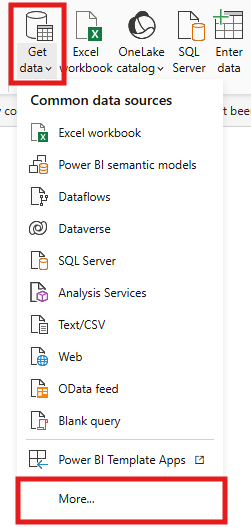

2. Search for **Login Enterprise**
3. Select it and click **Connect**

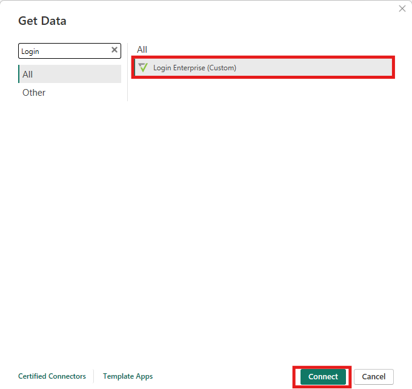

4. When prompted:
   - Enter your **FQDN** (e.g., `demolab.loginvsi.com`)
   - Enter your **Login Enterprise API Token** (View documentation [HERE](https://support.loginvsi.com/hc/en-us/articles/360009534760-Public-API) on how to add API access token)
   - Select the **Days Back** (a whole number from 1 to 365; the drop-down suggests 1, 7, 30, 60, 90). Rolling window: **today plus that many previous days**, in UTC.
   - **Use Date Range** – Select TRUE to ignore Days Back and use a fixed range instead.
   - **Start Date** / **End Date** – first and last day to include (both required when Use Date Range is TRUE; the whole End Date day is included).

   > Note: see [Date windows](#date-windows). Leaving Days Back blank means 30. If Use Date Range is TRUE and either date is missing, or Start is after End, the refresh fails with an explanatory message instead of silently using a different range.

   > **Token storage (legacy entry point).** The connection above passes the token as a function argument. Power BI stores it with the query/data source path (and in a `.pbix`/`.pbit` parameter), i.e. **in clear text inside the report**. Treat reports built this way as containing a secret, and see [Choosing how the token is supplied](#choosing-how-the-token-is-supplied) for the Key-credential alternative.

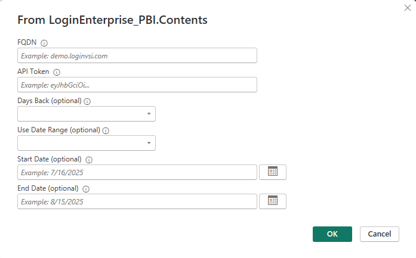

5. Click **OK**
6. When the authentication prompt appears, click **Connect**

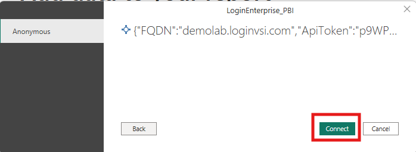

7. In the Navigator:
   - Select the tables you want to load (e.g., Test Runs, Events, Measurements)
   - Click **Load**

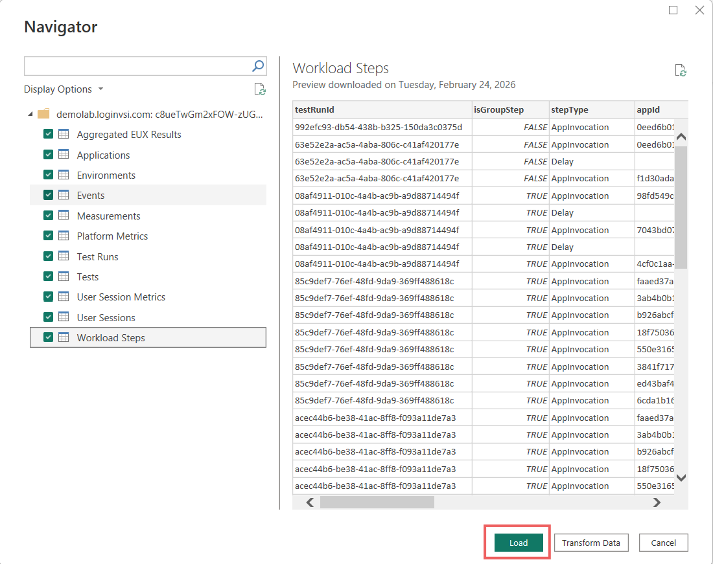

> ⏳ Data may take between 5-10 minutes to load depending on volume

### Choosing how the token is supplied

| | `LoginEnterprise_PBI.Contents(FQDN, ApiToken, ...)` (original) | `LoginEnterprise_PBI.ContentsKey(FQDN, ...)` (new in 1.1.0.2) |
|---|---|---|
| Authentication kind | Anonymous | Key (Power BI credential dialog) |
| Where the token lives | Query argument / report parameter (clear text in the file) | Power BI credential store, not in the query |
| Existing reports | Unchanged, keep working | Opt-in; needs the migration below |
| Status | Used by the template and by existing `.pbix` files | **Desktop Key Load/Refresh and fixed-window parity verified; remaining acceptance and Service limits are in docs/ACCEPTANCE.md** |

Migrating a report to the Key entry point (opt-in, reversible):
1. Keep the original `.pbix`. Work on a copy.
2. In each query's Advanced Editor change `LoginEnterprise_PBI.Contents(FQDN, APIToken, DaysBack, UseDateRange, StartDateParam, EndDateParam)` to `LoginEnterprise_PBI.ContentsKey(FQDN, DaysBack, UseDateRange, StartDateParam, EndDateParam)`.
3. When prompted, choose **Key** and paste the token into the credential dialog (not into a parameter). Delete the `APIToken` parameter (or leave it empty).
4. Refresh twice (first full refresh and a second refresh) and compare row counts with the original report.
5. **Rollback:** open the original `.pbix`; nothing about it changed. The old connector entry point is still in the same `.mez`.

---

## Data Model Overview

Understanding how the Login Enterprise tables relate to each other is key to building accurate and insightful Power BI reports. This section provides a simple overview of the core relationships between tables and how you can connect them in Power BI:

| From Table              | Field      | To Table              | Field | Relationship  |
|------------------------|------------|------------------------|-------|---------------|
| Test Runs              | `testId`   | Tests              | `id`  | Many-to-One   |
| Measurements           | `testRunId`| Test Runs          | `id`  | Many-to-One   |
| Events                 | `testRunId`| Test Runs          | `id`  | Many-to-One   |
| User Sessions          | `testRunId`| Test Runs          | `id`  | Many-to-One   |
| User Session Metrics   | `testRunId`| Test Runs          | `id`  | Many-to-One   |
| Workload Steps         | `testRunId`| Test Runs          | `id`  | Many-to-One   |
| Aggregated EUX Results | `testRunId`| Test Runs          | `id`  | Many-to-One   |
| Applications           | `id`       | Measurements       | `applicationId`  | Many-to-One   |
| Measurements           | `applicationId`       | Applications       | `id`  | Many-to-One   |
| Events           | `applicationId`       | Applications       | `id`  | Many-to-One   |
| Workload Steps           | `appId`       | Applications       | `id`  | Many-to-One   |
| Environments           | `id`       | Tests       | `environmentKey`  | Many-to-One   |
| Platform Metrics          | `environmentKey`       | Environments       | `id`  | Many-to-One   |

---

## On-Premise Data Gateway

**Not needed for Power BI Desktop.** Scheduled refresh in the Power BI service needs Microsoft's standard [on-premises data gateway](https://learn.microsoft.com/en-us/power-bi/connect-data/service-gateway-onprem), because this is a custom (non-certified) connector. That is a separate administrator-level operation; use the Key credential entry. The connector side (TestConnection, Key scope) is prepared and the runbook, preflight script and recovery table are in [docs/GATEWAY.md](docs/GATEWAY.md). **Gateway and Service refresh have not been run by this project**; scheduled Import refresh is not real-time and refreshing fixed historical data shows no new collection.

You can find step-by-step instructions for downloading, installing, and configuring the on-premises data gateway [HERE](https://learn.microsoft.com/en-us/data-integration/gateway/service-gateway-install).

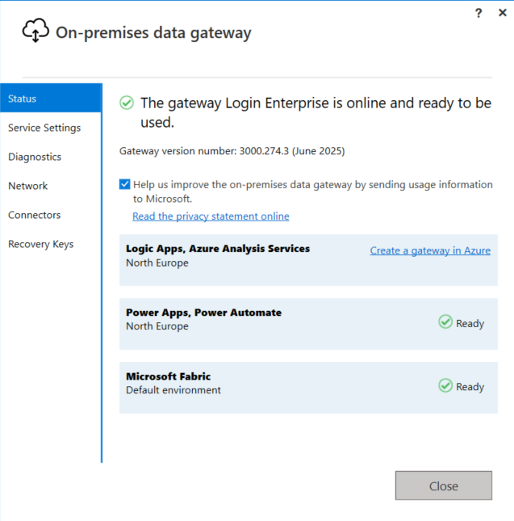

---

## Login Enterprise Power BI Template

Open the [tested template download](https://raw.githubusercontent.com/LoginVSI/LE-PBI-Connector/main/template/candidate/Login%20Enterprise%201.1.0.2-candidate.pbit) after installing the canonical connector above. Its repository path is `template/candidate/Login Enterprise 1.1.0.2-candidate.pbit`. The original `template/Login Enterprise.pbit` remains a historical compatibility reference.

The template prompts for `FQDN`, `APIToken`, `DaysBack`, `UseDateRange`, `StartDateParam` and `EndDateParam`. This template uses the legacy entry point, so enter the approved appliance and token locally and treat populated reports as containing a secret. The separate [Key migration](#choosing-how-the-token-is-supplied) avoids storing the token in M parameters while preserving the original report.

Save your populated working report as `.pbix`. To create a reusable template from Desktop, use **File > Export > Power BI template** and verify the save type is `.pbit`. A report named `.pbit.pbix` is still a report.

For a fixed range, set `UseDateRange` to True and enter dates as **YYYY-MM-DD**. For example, `StartDateParam = 2026-09-18` and `EndDateParam = 2026-09-24` select 18 through 24 September 2026. The end date includes the **entire UTC day** of 24 September, with an exclusive boundary at `2026-09-25T00:00:00Z`. Keep these parameter identifiers unchanged. ISO entry was accepted in the Desktop Date fields on the acceptance host with en-US regional settings. Other cultures have M parsing coverage, not Desktop control acceptance.

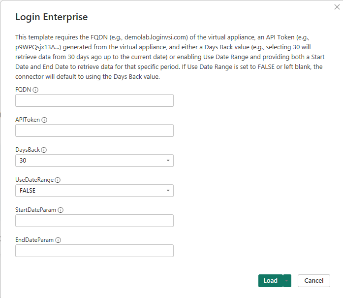

> NOTE: The connector will need to be placed in the Custom Connectors folder of your Power BI Desktop install previously to opening the `.pbit` file as shown above

### Test Name Slicer Behavior

By default, the Test Name slicer will display "All", but selecting "All" will not aggregate data across all tests. To view results, you must select a specific test from the list. This setup is intentional and helps prevent orphaned or inactive test names from appearing in the visuals and slicers throughout the report.

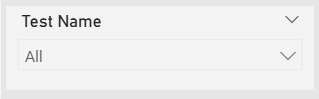

Below is a summary of the pages and their contents of the Login Enterprise template report:

### Summary
- Overview of total test runs and user sessions
- Success rate and average logon time across all tests
- Average EUX score trends by day
- Test run distribution by type (continuous, load, application)
- Daily user session counts broken down by login state (e.g., succeeded, failed, aborted)

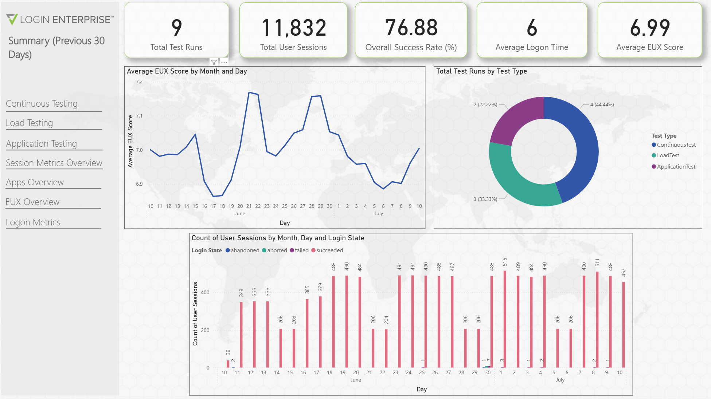

### Continuous Testing
- Displays long-term test results to monitor system health, stability, and user experience trends over time
- Tracks average EUX scores, logon time, latency, and resource usage (CPU and memory) by day
- Highlights failures and threshold violations such as login errors, latency spikes, or application crashes
- Helps detect gradual performance regressions, recurring issues, and environmental drift in persistent environments
- Learn more about Login Enterprise [Continuous Testing](https://support.loginvsi.com/hc/en-us/articles/360001310480-Manage-Tests-Continuous-Testing)

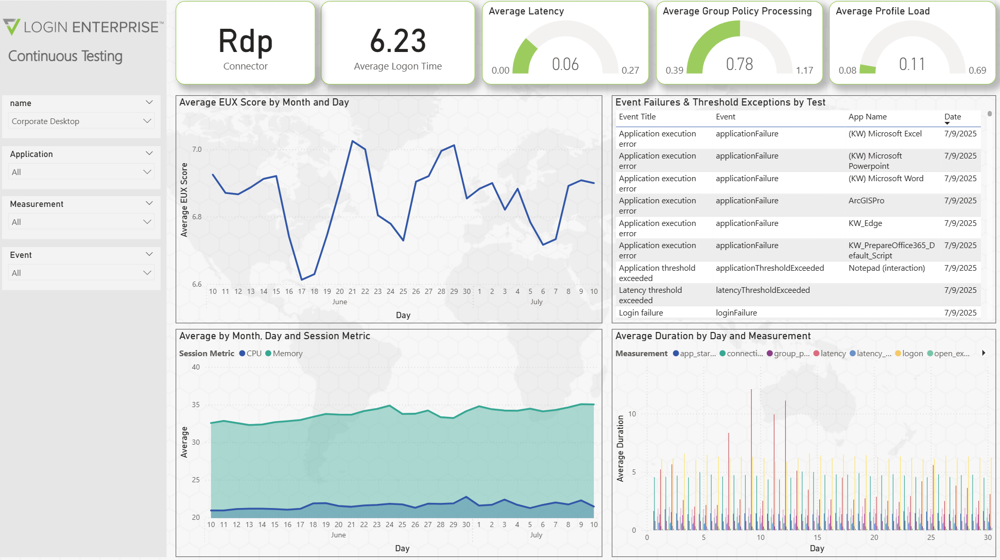

### Load Testing
- Displays detailed performance metrics from synthetic load tests, including logon time, EUX score, and VSI Max
- Visualizes session activity over time for CPU, memory, disk queue length, page faults, and other key system metrics
- Tracks application-level performance and failures by measurement type (e.g., app start, document open)
- Highlights average profile load, display protocol responsiveness, and group policy processing to assess user experience under load
- Learn more about Login Enterprise [Load Testing](https://support.loginvsi.com/hc/en-us/articles/360011050640-Manage-Tests-Load-Testing)

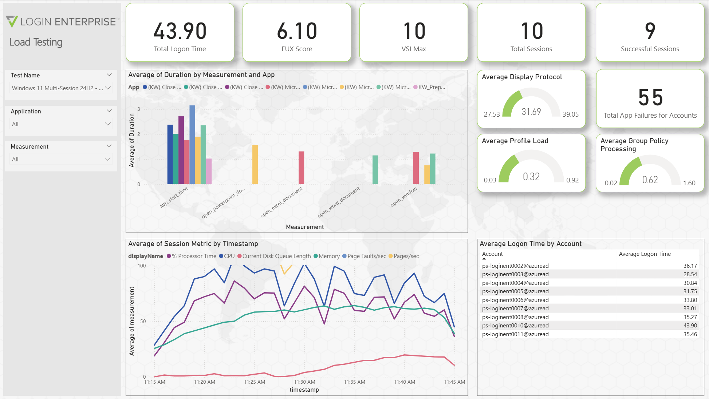

### Application Testing
- Displays pre-production image and application validation results across a range of test steps and actions
- Enables detailed analysis of individual app behaviors, including start time, document open time, and browser launch
- Highlights application failures with descriptive error types and affected app names for quick troubleshooting
- Supports change control and post-deployment QA by measuring logon time, latency, and step duration across all tested applications
- Learn more about Login Enterprise [Application Testing](https://support.loginvsi.com/hc/en-us/articles/360012843980-Manage-Tests-Application-Testing)

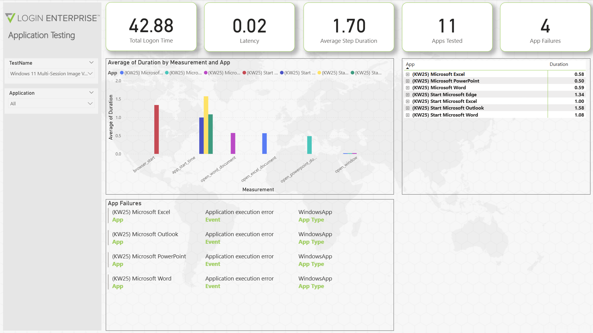

### Session Metrics Overview
- Compare average CPU and memory usage between two test runs (A and B) across days and time intervals
- Visualize trends over time with daily averages and timestamp-level granularity
- Track min, avg, and max values for both CPU and memory usage to assess consistency and performance stability
- Useful for evaluating performance impact of infrastructure, image, or configuration changes across environments
- Learn more about Login Enterprise [Session Metrics](https://support.loginvsi.com/hc/en-us/articles/9776492249884-Session-Metrics)

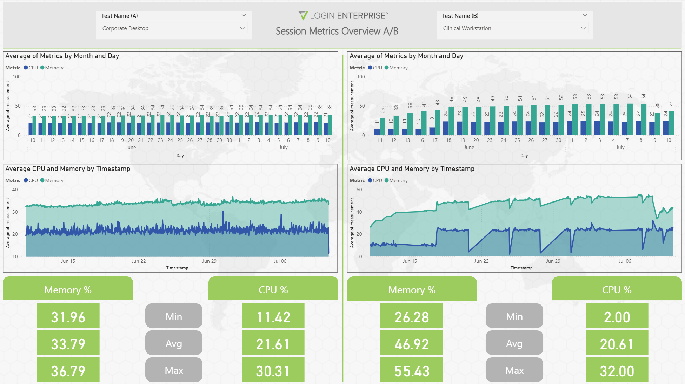

### Apps Overview
- Side-by-side comparison of application performance between two selected test runs (A vs. B)
- Visualizes average duration for key application measurements (e.g., app start time, document open) across days
- Bar charts and donut charts show breakdowns by measurement type and app type
- Ideal for A/B testing scenarios such as comparing golden images, application versions, or infrastructure changes
- Learn more about Login Enterprise [Applications](https://support.loginvsi.com/hc/en-us/articles/360001341979-Applications)

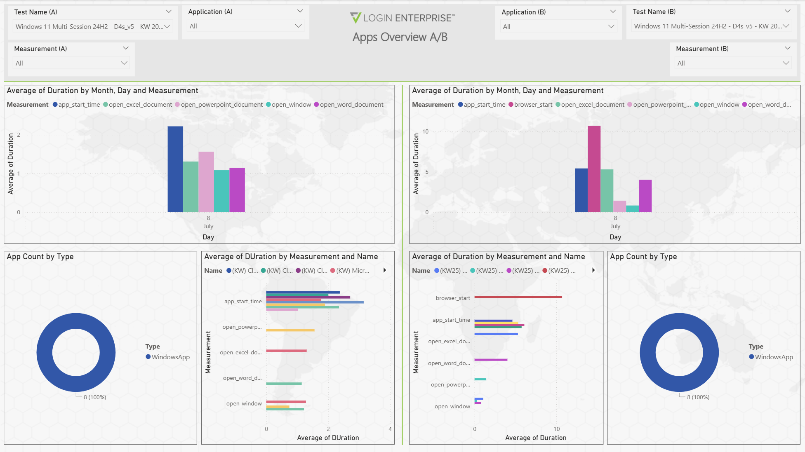

### EUX Overview
- Provides a side-by-side comparison of EUX (End User Experience) scores between two selected test runs or environments
- Displays minimum, average, and maximum EUX scores for each test to help evaluate overall user experience quality
- Charts EUX score fluctuations over time to identify degradation, instability, or performance improvements
- Ideal for comparing image optimizations, infrastructure changes, or platform transitions (e.g., on-prem vs. AVD)
- Learn more about Login Enterprise [EUX Score](https://support.loginvsi.com/hc/en-us/articles/4408717958162-Login-Enterprise-EUX-score-and-VSImax)

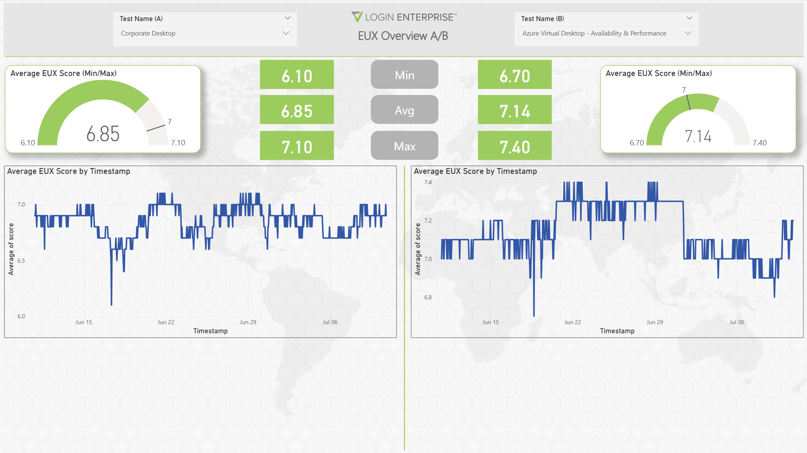

### Login Metrics
- Compares total logon time performance between two selected test runs across user accounts and time intervals
- Breaks down contributing factors such as display connection time, group policy processing, and profile load
- Visualizes minimum, average, and maximum total logon times, along with trends by timestamp and user
- Identifies slow or failed user sessions to support root cause analysis and image optimization

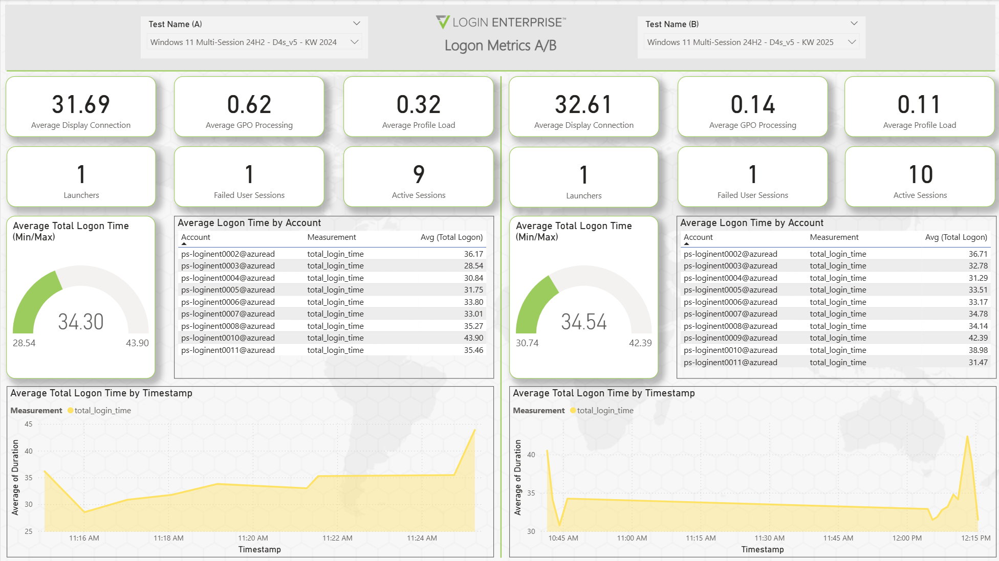

### Platform Metrics Overview
- Provides a dedicated view of platform telemetry for a selected Login Enterprise environment, making it easier to understand, analyze, and compare infrastructure behavior
- Supports environment-based filtering with a friendly environment selector, while still allowing users to search by Environment ID when needed
- Enforces single-unit analysis so only one metric unit is displayed at a time, preventing mixed-unit charts and improving readability
- Charts platform metric trends over time across the selected reporting window, including signals such as latency, bandwidth, IOPS, CPU, memory, storage, and other available platform metrics
- Supports instance-aware analysis for scenarios where the same metric is collected from multiple sources, such as multiple launcher hostnames during a load test
- Displays associated Login Enterprise tests for the selected environment to help connect infrastructure behavior back to test activity
- Extends the existing Login Enterprise template with a pre-built, no-modeling-required experience for platform-level telemetry analysis

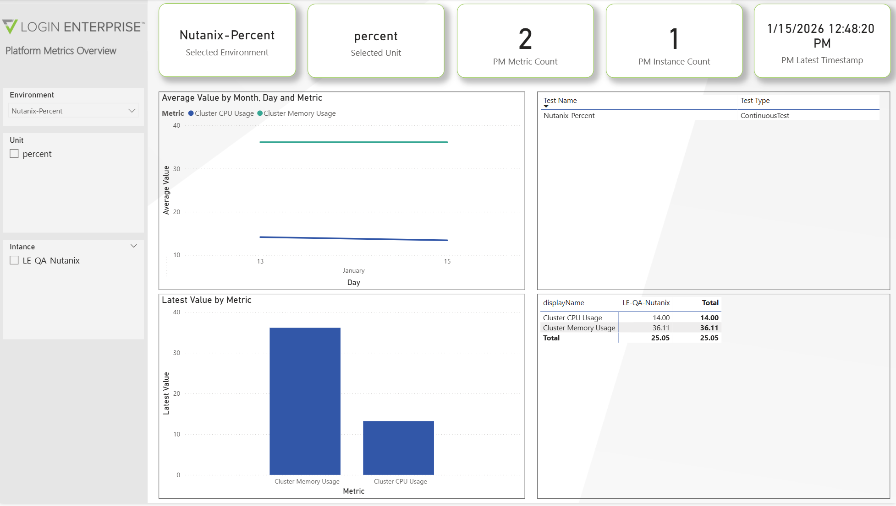

## Customzing the Login Enterprise Template Report
The template report is fully customizable, allowing customers to tailor it to their unique environment and reporting needs. Users can modify visuals, add custom measures, or integrate additional data sources to align with internal KPIs or business goals. Once finalized, the report can be published to the Power BI Service for automated refreshes, collaboration, and sharing across teams or departments.

- Learn more about [publishing reports from Power BI Desktop](https://learn.microsoft.com/en-us/power-bi/create-reports/desktop-upload-desktop-files)
- Learn how to establish [scheduled data refreshes on the semantic model](https://learn.microsoft.com/en-us/power-bi/connect-data/refresh-scheduled-refresh)

> NOTE: As mentioned previously, the on-premise data gateway will need to be established in order for the published template report to run on its scheduled refresh
---

## Date windows

Point observations use this UTC-day policy; run/session tables have interval semantics described below:

- A "day" is a **UTC calendar day**. The window is `[Start 00:00Z, End+1 00:00Z)`, so the selected end day (including today) is fully included and an observation exactly at midnight belongs to one day only.
- **Rolling (Use Date Range off):** end = today (UTC), start = today minus *Days Back*. `Days Back = 1` therefore covers today and yesterday.
- **Fixed (Use Date Range on):** Start and End are both required, Start must not be after End, and the span is limited to 366 days.
- Rolling Days Back is 1..365 (plus today); fixed ranges are at most 366 days. Invalid input is an error, never silently widened or swapped. Omitted Days Back defaults to 30.
- The window does not depend on the refreshing machine's time zone or daylight saving. **However**, Power Query converts the API's UTC timestamps to the *local time of the machine that refreshes* when it types `datetime` columns (verified on the Power Query engine). Desktop on a UTC-7 laptop and the Service (UTC) therefore show the same instants as different clock times, and a report's "today" in DAX is local. Keep that in mind when reconciling with the Login Enterprise UI.
- Test Runs retains an unfiltered metadata catalog. Configuration snapshots and derived workload steps are retrieved only for overlapping Application/Load runs; out-of-window catalog rows have null snapshots. A selected snapshot retrieval failure fails refresh. The template uses Filtered Test Runs for loaded-window reporting. Sessions are active intervals, so a session spanning adjacent windows can appear in both. Count distinct IDs across their union. For acquisition, per-run data (measurements, sessions, EUX, metrics) is only fetched for runs whose start/finish overlaps the window, which includes runs that are still running (for example long-lived Continuous tests).

## What the connector now does differently (1.1.0.2)

- Paged lists are read through an empty terminator, including capped pages without totals (`count`/`offset` added exactly once; offsets and totals cross-checked). Previously measurements were truncated at 1000 rows per run per day, applications sent duplicate paging parameters, and environments read one page.
- A failed request is an error with context (HTTP status, route, hint) instead of an empty table. The token is never included in error text. Transient statuses (408/429/5xx) get at most three attempts with 1/2-second retry delays. Requests have 30-second timeouts and paged reads stop at 1000 pages. A shared 300-second cooperative request budget is checked before attempts and after bodies; it cannot interrupt an in-flight request or decoding and is not a hard overall refresh deadline. Separate evaluations have separate budgets. See [audit limitations](docs/INDEPENDENT-AUDIT.md). Queried-route 404s fail refresh; absent data must be an empty success response.
- A `Test Runs In Window` navigation item was added (used by the 1.1.0.2 template so failed runs without data stay visible). Existing navigation items, tables and columns are unchanged.
- 1.2.0.0 appends a `Load Test Overview` navigation item with the appliance's native whole-run EUX results. Existing items, tables and columns are still unchanged. See [docs/NATIVE-EUX.md](docs/NATIVE-EUX.md).

## Troubleshooting

| Symptom | Likely cause | What to do |
|---|---|---|
| Login Enterprise is not in Get Data | `.mez` not in the per-user folder, wrong folder, or Desktop not fully restarted | Re-run the folder commands in Step 2 and restart Desktop completely |
| Old behaviour after upgrade | Two connector files in the folder | Remove the older `.mez` (see Step 2) |
| "Could not complete the request ... never disables certificate validation" | DNS/network problem or the appliance certificate is not trusted | Verify the FQDN in a browser; install the appliance CA (see Prerequisites). Do not disable TLS checks |
| "HTTP 401 ... Authentication failed" | Token missing/expired/revoked | Create a new token in the appliance and update the parameter/credential |
| "HTTP 403" | Token's user lacks permission | Use a token with the required read access |
| "HTTP 400 ... rejected the request parameters" | Appliance API differs from the v7-preview contract this connector targets | Note the appliance version and the route in the message; open an issue with that text (no token) |
| "Pagination made no progress" / "Incomplete result" | Appliance ignores or caps paging | Report the route in the message; refresh will not publish a partial table |
| "Use Date Range is enabled but Start Date and End Date are not both set" | Partial fixed range | Set both dates or turn Use Date Range off |
| Prompt for credentials on every refresh | Anonymous legacy entry point cached with a token that changed | Edit the parameter and clear/re-apply permissions in Data source settings |

**Diagnostics:** in Desktop use *Home > Transform data > View > Query Diagnostics* or the Power Query trace options, and capture the error text. Redact FQDNs and never share tokens.

## Upgrade and rollback

1. Close Power BI Desktop. 2. Move the old `.mez` out of `Custom Connectors` to a backup folder (keep it for rollback). 3. Copy the new `LE-PBI-Connector.mez` in. 4. Start Desktop, open your report and **Refresh**. 5. Compare row counts for Test Runs, Measurements, User Sessions and Events with the previous refresh (Measurements will increase if you previously hit the 1000-row truncation).

Rollback: close Desktop, delete the new `.mez`, copy the old one back, restart. Reports are unchanged by the connector upgrade (the entry point and table schemas are the same).

To rebuild the package from source (PowerShell 7): `pwsh build/Build-Mez.ps1`; the build is byte-reproducible and CI checks `bin/AnyCPU/Debug/LE-PBI-Connector.mez` against the source. Tests: `pwsh tests/Run-Tests.ps1` (downloads the pinned Power Query SDK test tool from NuGet; no Power BI Desktop involved).

## Template changes in 1.1.0.2

The original `template/Login Enterprise.pbit` is unchanged. `template/candidate/Login Enterprise 1.1.0.2-candidate.pbit` is the Desktop-accepted template; `1.2.0.0-candidate` adds native EUX measures (not yet opened in Desktop). What changed and why: [docs/TEMPLATE-CHANGES.md](docs/TEMPLATE-CHANGES.md). Editable DAX/M sources: `template/source/`.

### First-load snapshot failure

On the acceptance appliance, expanding some older stored run snapshots returns HTTP 500 even for count 1. The candidate now enumerates run metadata without expansion and retrieves snapshots for overlapping Application/Load runs through the verified v7-preview single-run route. This preserves workload steps for the selected window while avoiding expansion of unrelated broken history. Selected-run failures remain errors. See [the failed Desktop attempt and verified workaround](docs/DESKTOP-LOAD-FAILURE.md). The retry succeeded and is recorded in [DESKTOP-ACCEPTANCE.md](docs/DESKTOP-ACCEPTANCE.md).
